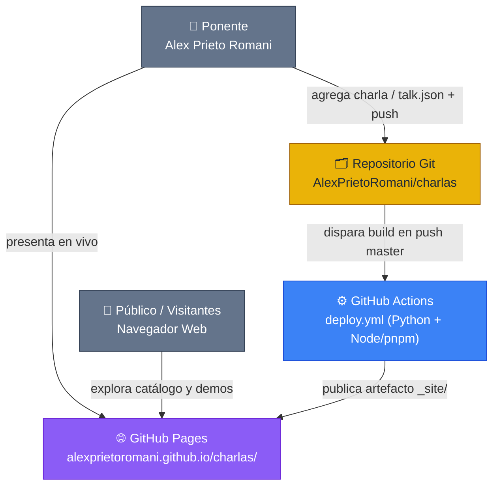
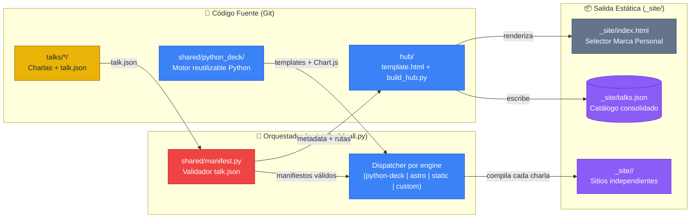
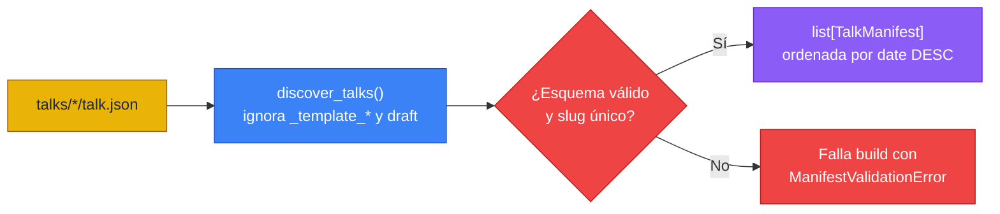

# Arquitectura del Sistema — `charlas` (`AlexPrietoRomani/charlas`)

> **Propósito:** Describe la arquitectura técnica C4, los flujos de datos end-to-end, sus invariantes obligatorias, el modelo de despliegue y las decisiones arquitectónicas (ADRs) del repositorio multicharla.
> **Documentos relacionados:**
> - Definición funcional: [`../description_proyecto.md`](../description_proyecto.md)
> - Esquema de manifiestos y datos: [`../db/diseno_db.md`](../db/diseno_db.md)
> - Guía de ejecución: [`../ejecucion.md`](../ejecucion.md)

---

## 1. Diagrama de Contexto (C4 Nivel 1)

---

## 2. Diagrama de Contenedores (C4 Nivel 2)

---

## 3. Mapa Maestro de Flujos

| ID | Flujo | Script / Módulo principal | Entrada | Salida |
|---|---|---|---|---|
| **F1** | Descubrimiento y validación de manifiestos | `shared/manifest.py` | `talks/*/talk.json` | Lista tipada `list[TalkManifest]` |
| **F2** | Build de charlas `python-deck` | `shared/python_deck/build_deck.py` + `talks/<slug>/back/build.py` | Slides + Notas + CSVs `data/` | `_site/<slug>/index.html` + assets |
| **F3** | Build de charlas `astro` | `scripts/build_all.py` → `pnpm astro build` | `talks/<slug>/src/` + `public/` | `_site/<slug>/` (desde `dist/`) |
| **F4** | Build/Copia de charlas `static` y `custom` | `scripts/build_all.py` | HTML estático o `build.cmd` | `_site/<slug>/` |
| **F5** | Compilación del Hub Selector | `hub/build_hub.py` | `hub/template.html` + `list[TalkManifest]` | `_site/index.html` + `_site/talks.json` |
| **F6** | Pipeline CI/CD GitHub Pages | `.github/workflows/deploy.yml` | Push a `master` | Deploy en GitHub Pages (`_site/`) |

---

## 4. Detalle de Flujos Técnicos

### Flujo F1 — Descubrimiento y Validación de Manifiestos
**Entrada → Proceso → Salida:** Carpetas en `talks/` → escaneo alfabético, validación de esquema JSON y verificación de `slug` único → catálogo ordenado de charlas publicables.
- **Módulo:** `shared/manifest.py`
- **Invariante:** Ninguna charla con `"draft": true` o carpeta `_template_*` entra al catálogo de producción; dos charlas activas nunca pueden compartir `slug`.

### Flujo F2 — Build de Charlas `python-deck`
**Entrada → Proceso → Salida:** Slides, notas y CSVs de una charla → inyección de JSON sanitizado (`clean_nans`) + CSS compartido/override + Chart.js offline → HTML single-file autónomo.
- **Módulos:** `shared/python_deck/` + `talks/<slug>/back/build.py`
- **Invariante:** El HTML generado no contiene `NaN` literales en `window.DECK_DATA` y funciona 100% offline con sus activos copiados.

### Flujo F3 — Build de Charlas `astro`
**Entrada → Proceso → Salida:** Proyecto Astro en `talks/<slug>/` → instalación determinista `pnpm` y build con `--base /<repo_base>/<slug>` → bundle estático en `_site/<slug>/`.
- **Módulo:** `scripts/build_all.py` (subproceso `pnpm`)
- **Invariante:** Toda ruta de activos (`assets/`, `data/`, `_astro/`) resuelve correctamente bajo el subpath `/charlas/<slug>/` sin colisionar con la raíz `/charlas/`.

### Flujo F4 — Build/Copia `static` y `custom`
**Entrada → Proceso → Salida:** Charla HTML/Reveal.js o Quarto/Slidev → copia directa o ejecución de `build.cmd` → artefacto autocontenido en `_site/<slug>/`.
- **Invariante:** El punto de entrada `entry` (default `index.html`) debe existir en `_site/<slug>/` al terminar el paso; de lo contrario el build aborta.

### Flujo F5 — Generación del Hub Selector
**Entrada → Proceso → Salida:** `hub/template.html` + catálogo `talks` → copia de portadas al directorio `_site/hub_assets/` e inyección del JSON de catálogo → `_site/index.html` y `_site/talks.json`.
- **Módulo:** `hub/build_hub.py`
- **Invariante:** El Hub nunca incluye logos de terceros en su cabecera (solo identidad **Alex Prieto Romani**) y cada tarjeta apunta a `<slug>/` con portada existente.

### Flujo F6 — Despliegue CI/CD en GitHub Pages
**Entrada → Proceso → Salida:** Push en `master` → Actions instala Python 3.11 + Node 22 + pnpm, corre `scripts/build_all.py` y `pytest` → sube `_site/` con `actions/deploy-pages@v4`.
- **Archivo:** `.github/workflows/deploy.yml`
- **Invariante:** Si falla la validación de manifiestos, cualquier compilación de charla o la suite de tests, el workflow aborta antes de desplegar a Pages.

---

## 5. Modelo de Datos

El detalle del esquema `talk.json`, el catálogo `_site/talks.json`, las políticas de escritura y la matriz CRUD por componente se encuentran en [`../db/diseno_db.md`](../db/diseno_db.md).

---

## 6. Arquitectura de Despliegue y Bundle

- **Bundle desplegado (`_site/`, generado y no versionado):**
  - `_site/index.html` + `_site/talks.json` + `_site/hub_assets/` (foto de perfil, portadas cacheadas, favicon)
  - `_site/2026-forecasting-ia/index.html` + `presentacion.html` + `data/` + `docs/images/`
  - `_site/2026-falsa-alarma/` (salida de `astro build` con `index.html`, `_astro/`, `assets/`, `data/`)
- **Exclusiones estrictas de Git:** `_site/`, `dist/`, `node_modules/`, `.astro/`, `talks/2026-forecasting-ia/presentacion.html`, archivos `.exe`, `.pdf`, pesos de modelos y credenciales.

---

## 7. Registro de Decisiones Arquitectónicas (ADRs)

| ID | Decisión | Alternativa descartada | Justificación |
|---|---|---|---|
| **ADR-01** | **Arquitectura multi-motor por carpeta (`talks/<slug>/talk.json`)** | Reescribir todas las charlas en Astro o en Python | Permite conservar `2026-forecasting-ia` (Python/Chart.js) y `2026-falsa-alarma` (Astro) sin reescribirlas, y habilita futuros decks en Reveal.js/Quarto/HTML puro. |
| **ADR-02** | **Separar marca del Hub (personal: Alex Prieto Romani) vs. branding por charla** | Mantener branding `Data_Wizard` en el Hub raíz | El repositorio pertenece a la marca personal del ponente; las charlas de eventos o colaboraciones conservan su estética solo dentro de su propia ruta `/<slug>/`. |
| **ADR-03** | **No versionar artefactos compilados (`_site/`, `presentacion.html` de 7.3 MB, `dist/`)** | Commitear `presentacion.html` y `dist/` en Git | Evita diffs binarios gigantes en cada cambio y garantiza que GitHub Actions regenere el sitio desde fuente limpia. Para uso offline se corre `python scripts/build_all.py`. |
| **ADR-04** | **Parametrizar `base` de Astro vía CLI/env (`--base /<repo>/<slug>`)** | Hardcodear `/charlas/...` en `astro.config.mjs` | Permite probar la charla Astro localmente en `/` o en subpath `/charlas/2026-falsa-alarma/` sin editar código fuente entre entornos. |
