# Diseño de Persistencia y Esquemas de Datos — `charlas`

> **Propósito:** Documenta los contratos de datos estructurados (manifiestos `talk.json`, catálogo compilado `_site/talks.json` y payloads CSV/JSON por charla), sus reglas de integridad y qué componente lee o escribe cada archivo.
> **Flujo de origen:** [`../architecture/architecture.md`](../architecture/architecture.md)

---

## Mapa de Almacenes de Datos

| Archivo / Recurso | Tipo | Descripción | Tamaño aprox. | ¿Se despliega en `_site/`? |
|---|---|---|---|---|
| `talks/<slug>/talk.json` | Fuente (Manifiesto) | Metadatos, motor (`engine`), portada y links de cada charla | < 2 KB c/u | No directo (se consolida en `talks.json`) |
| `_site/talks.json` | Consumo (Derivado) | Catálogo unificado de todas las charlas publicables | < 15 KB | Sí |
| `talks/2026-forecasting-ia/data/` | Fuente / Consumo | CSVs y JSON auditados de Caso 1 (SENAMHI) y Caso 2 (Café Jaén) | ~500 KB | Sí (dentro de `/2026-forecasting-ia/data/`) |
| `talks/2026-falsa-alarma/public/data/` | Fuente / Consumo | `clima_valle_elqui.csv` y `rendimiento_fresa.csv` | ~3 KB | Sí (dentro de `/2026-falsa-alarma/data/`) |

---

## 1. Modelo Lógico de Catálogo (`talk.json` → `talks.json`)

```mermaid
erDiagram
    TALK_MANIFEST ||--o| BUILD_CONFIG : "opcional (custom/astro)"
    TALK_MANIFEST ||--o| EXTRAS_LINKS : "opcional"
    CATALOG_OUTPUT ||--|{ TALK_MANIFEST : "agrega charlas activas"

    TALK_MANIFEST {
        TEXT slug PK "^[a-z0-9-]+$, único entre charlas activas"
        TEXT title "Título principal de la ponencia"
        TEXT subtitle "Subtítulo opcional"
        TEXT event "Evento o contexto"
        TEXT date "ISO YYYY-MM-DD"
        TEXT engine "python-deck | astro | static | custom"
        TEXT entry "Default index.html"
        TEXT cover "Ruta relativa a imagen de portada"
        INTEGER slides_count "Opcional, >= 1"
        INTEGER duration_min "Opcional, >= 1"
        BOOLEAN draft "Opcional, default false"
        JSON tags "Lista no vacía de strings"
    }

    BUILD_CONFIG {
        TEXT cmd "Comando de compilación custom"
        TEXT out_dir "Directorio de salida generado"
    }

    EXTRAS_LINKS {
        TEXT notebooks "Ruta o URL a notebooks"
        TEXT repo "URL o ruta a código fuente"
    }

    CATALOG_OUTPUT {
        TEXT generated_at "Timestamp ISO UTC"
        TEXT base_path "Subpath de Pages (ej. /charlas)"
        INTEGER total_talks "Cantidad de charlas publicadas"
        JSON talks "Arreglo ordenado por date DESC"
    }
```

---

## 2. Diccionario de Campos

### 2.1 `talks/<slug>/talk.json`

| Campo | Tipo | Obligatorio | Restricción / Valores | Descripción |
|---|---|---|---|---|
| `slug` | `string` | Sí | `^[a-z0-9-]+$`, debe coincidir con el nombre de la carpeta | Identificador de URL (`/<base>/<slug>/`) |
| `title` | `string` | Sí | Longitud 3–160 caracteres | Título mostrado en tarjeta del Hub |
| `subtitle` | `string` | No | Texto breve | Bajada o resumen corto |
| `event` | `string` | Sí | Texto no vacío | Nombre del evento o categoría |
| `date` | `string` | Sí | Formato `YYYY-MM-DD` válido | Fecha de la charla (ordena el Hub DESC) |
| `engine` | `string` | Sí | `python-deck` \| `astro` \| `static` \| `custom` | Motor usado para construir la charla |
| `tags` | `list[string]` | Sí | Mínimo 1 etiqueta | Etiquetas buscables y mostradas en tarjeta |
| `entry` | `string` | No | Default `"index.html"` | Archivo HTML principal dentro de la salida |
| `cover` | `string` | No | Ruta relativa existente dentro de la charla | Imagen de portada en el Hub |
| `slides_count` | `int` | No | Entero `>= 1` | Cantidad de diapositivas |
| `duration_min` | `int` | No | Entero `>= 1` | Duración estimada en minutos |
| `draft` | `bool` | No | Default `false` | Si es `true`, se excluye del Hub público |
| `build` | `object` | No | `{ "cmd": str, "out_dir": str }` | Requerido cuando `engine == "custom"` |
| `extras` | `object` | No | `{ "notebooks"?: str, "repo"?: str }` | Enlaces adicionales en tarjeta |

---

## 3. Políticas de Escritura y Matriz CRUD por Componente

| Recurso | `shared/manifest.py` | `scripts/build_all.py` | `hub/build_hub.py` | `hub/template.html` (JS cliente) |
|---|---|---|---|---|
| `talks/*/talk.json` | **R** (valida) | **R** | **R** | — |
| `_site/talks.json` | — | — | **W** (sobrescribe en cada build) | **R** (catálogo embebido / fetch) |
| `_site/<slug>/*` | — | **W** (limpia y regenera) | — | **R** (navega al presentar) |
| `talks/<slug>/data/*` | — | **R** (copia si aplica) | — | — |

**Política de escritura:** El directorio `_site/` es 100% regenerable (idempotente): `scripts/build_all.py` recrea el directorio destino limpio en cada corrida para evitar archivos huérfanos de charlas eliminadas o renombradas.
