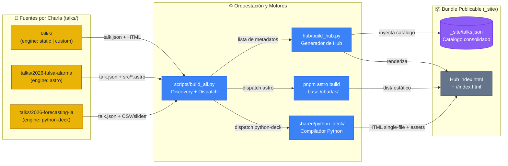

# Documento de Definición Técnica — charlas (`AlexPrietoRomani/charlas`)

> **Propósito:** Única fuente de verdad técnica y funcional para desarrolladores, arquitectos y agentes de IA. Define qué hace el repositorio central de charlas, cómo están organizados sus componentes, cómo fluyen los manifiestos/datos y qué reglas rigen la publicación multicharla.
> **Autor:** Alex Prieto <alexprieto1997@gmail.com>

---

## 0. Resumen ejecutivo

- **Propósito:** Repositorio unificado y sitio estático en GitHub Pages (`https://alexprietoromani.github.io/charlas/`) que centraliza todas las ponencias técnicas de **Alex Prieto Romani** bajo una página principal tipo Hub/Selector, permitiendo presentar en vivo o explorar charlas con múltiples estilos y motores (`python-deck`, `astro`, `static`, `custom`).
- **Usuarios objetivo:**
  1. **Ponente (Alex Prieto Romani):** selecciona rápidamente qué charla presentar en vivo (con modo presentador, atajos y respaldo local 100% offline).
  2. **Público / Comunidad:** navega el catálogo, filtra por motor/tema, abre cualquier presentación interactiva y accede a notebooks o repositorios asociados.
  3. **Pipeline CI/CD (GitHub Actions):** descubre, valida, compila y despliega automáticamente todas las charlas registradas en cada `push` a `master`.
- **Casos de uso principales:**
  1. **Selección y presentación en vivo:** El usuario abre `/` → busca o filtra la charla → hace clic en `▶ Presentar` → accede a `/<slug>/` con su propio diseño intacto.
  2. **Incorporación de nueva charla (mismo estilo o diferente estilo):** El autor copia una plantilla en `talks/`, define `talk.json` (eligiendo `python-deck`, `astro`, `static` o `custom`) → el orquestador la descubre automáticamente sin modificar el Hub.
  3. **Regeneración automática en GitHub Pages:** Un `push` a `master` ejecuta `build_all.py`, compila cada charla según su `engine`, genera `_site/index.html` y `_site/talks.json`, y publica en GitHub Pages.

---

## 1. Arquitectura de componentes

> Para el detalle completo de los 6 flujos técnicos, invariantes y decisiones arquitectónicas (ADRs), ver [`docs/architecture/architecture.md`](architecture/architecture.md).

---

## 2. Flujos de datos

1. **Flujo 1 — Descubrimiento y validación de manifiestos:** `scripts/build_all.py` escanea `talks/*/talk.json` (excluyendo `_template_*` y charlas con `"draft": true`), valida esquema y unicidad de `slug`.
2. **Flujo 2 — Compilación `python-deck`:** Lee slides/notas de la charla y payloads CSV/JSON de `data/`, reutiliza el motor compartido `shared/python_deck/` (CSS base, Chart.js offline, helpers) y emite `_site/<slug>/index.html` + recursos estáticos.
3. **Flujo 3 — Compilación `astro`:** Ejecuta `pnpm install --frozen-lockfile` y `pnpm astro build --base /charlas/<slug>` dentro de la carpeta de la charla y copia `dist/` hacia `_site/<slug>/`.
4. **Flujo 4 — Copia/Build `static` y `custom`:** Copia sitios HTML/Reveal.js estáticos o ejecuta `build_cmd` declarado y publica la salida hacia `_site/<slug>/`.
5. **Flujo 5 — Generación del Hub Selector:** `hub/build_hub.py` combina `hub/template.html` con el catálogo compilado (`talks.json`), copia portadas e identidad personal de Alex Prieto Romani y escribe `_site/index.html`.
6. **Flujo 6 — Despliegue CI/CD en GitHub Pages:** `.github/workflows/deploy.yml` ejecuta `build_all.py` con Python 3.11 + Node 22 + pnpm y despliega `_site/` completo.

---

## 3. Modelo de datos

El repositorio no utiliza base de datos SQL; la persistencia estructurada se basa en contratos JSON/CSV versionados en Git y artefactos derivados en `_site/`:
- **Manifiesto por charla (`talks/<slug>/talk.json`):** fuente de la verdad de metadatos, motor (`engine`), portada (`cover`), etiquetas y configuración de build.
- **Catálogo consolidado (`_site/talks.json`):** artefacto derivado regenerable consumido por el Hub y por las pruebas automatizadas.
- **Datos de dominio por charla (`talks/<slug>/data/` o `public/data/`):** CSVs/JSONs auditados propios de cada ponencia.

> Ver el esquema completo, diccionario de campos, reglas de integridad y matriz CRUD en [`docs/db/diseno_db.md`](db/diseno_db.md).

---

## 4. Contratos de interfaz

### Contrato de Manifiesto `talk.json`

Cada subcarpeta activa bajo `talks/` debe contener un `talk.json` conforme al esquema validado por `shared/manifest.py`:
- Campos obligatorios: `slug` (`^[a-z0-9-]+$`), `title`, `event`, `date` (`YYYY-MM-DD`), `engine` (`"python-deck" | "astro" | "static" | "custom"`), `tags` (lista no vacía).
- Campos opcionales: `subtitle`, `slides_count`, `duration_min`, `cover` (ruta relativa dentro de la charla), `draft` (bool, default `false`), `entry` (default `"index.html"`), `build` (`{ "cmd": str, "out_dir": str }`), `extras` (`{ "notebooks": str, "repo": str }`).

---

## 5. Reglas de negocio y validación

- **Marca personal en el Hub:** El Hub raíz (`/`) representa únicamente la marca personal **Alex Prieto Romani** (sin logos ni branding de colaboraciones externas en la cabecera general). Las charlas individuales conservan la estética propia de su evento/estilo (p. ej. `2026-forecasting-ia` conserva su identidad de Iquitos Data Fest 2026).
- **Aislamiento de estilos por charla:** Cada charla se sirve en su propia ruta `/<slug>/` y es libre de usar `python-deck`, `astro`, `Reveal.js`, `Quarto` o HTML/CSS propio sin interferir con el Hub ni con otras charlas.
- **Cero binarios/instaladores pesados en Git:** Se excluyen archivos compilados pesados (`_site/`, `presentacion.html` compilados, `dist/`, `node_modules/`, `.exe`, `.pdf`, pesos de modelos) del control de versiones; GitHub Actions los regenera determinísticamente.
- **Unicidad de `slug`:** Dos charlas activas no pueden declarar el mismo `slug`; el orquestador falla rápido ante colisiones o portadas faltantes.

---

## 6. UI/UX — Hub Selector Principal

- **Tipo:** Aplicación estática de catálogo y lanzador en vivo (`_site/index.html`), sin servidor backend en producción.
- **Controles interactivos:**
  - Buscador instantáneo por título, evento, descripción o tags.
  - Filtros tipo píldora por motor/estilo (`Todas`, `Python Deck`, `Astro`, `Otros estilos`).
  - Toggle **Modo Presentador** que habilita atajos de teclado y enlaces directos para proyector.
  - Modal de inspección (`{ } Config`) que muestra el `talk.json` real de cada charla.
- **Comportamiento:** Todo el filtrado ocurre en el cliente sobre el catálogo JSON inyectado en build-time (funciona tanto en GitHub Pages como offline vía `file://` o servidor local).

---

## 7. Configuración y despliegue

- **Entorno local:** `python scripts/build_all.py` genera `_site/` listo para abrir o servir con `python -m http.server -d _site 8000`.
- **Producción (GitHub Pages):** `.github/workflows/deploy.yml` en rama `master`, configurando Python 3.11 + Node 22 + pnpm, desplegando `_site/` bajo `https://alexprietoromani.github.io/charlas/`.
- **Guía completa de arranque y troubleshooting:** [`docs/ejecucion.md`](ejecucion.md).
