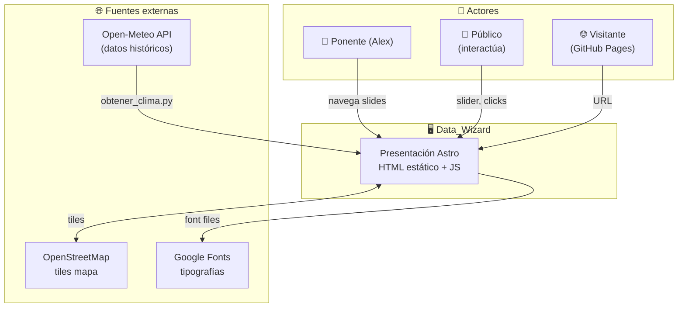
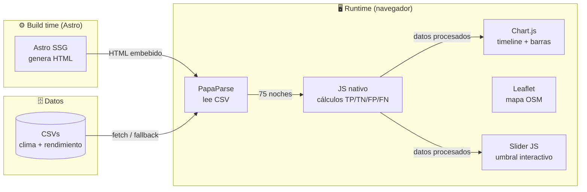
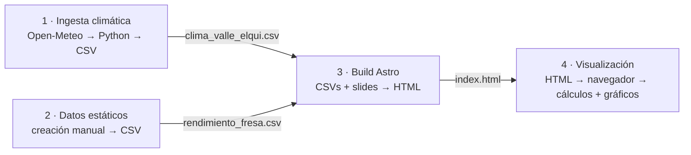
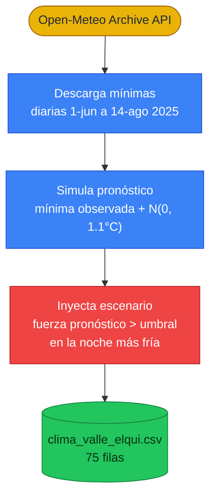
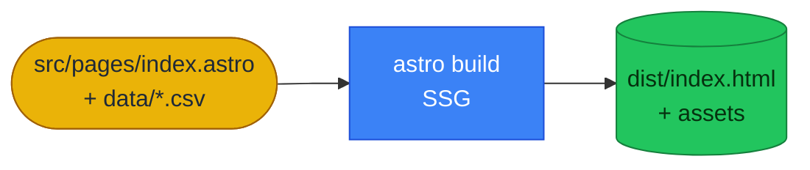
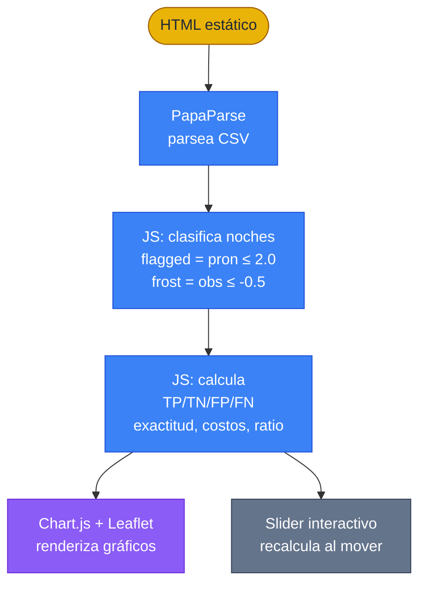
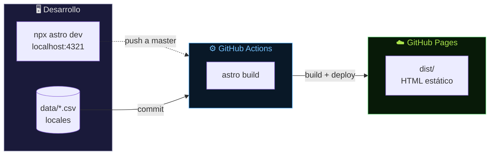

# Arquitectura — Data_Wizard

---

## 1. Visión General del Sistema (C4 – Nivel Contexto)

**Decisiones arquitectónicas clave (Nivel Macro):**
- **Motor de presentación:** Astro 7 SSG → genera HTML estático sin runtime server. Se eligió por build rápido, output estático (GitHub Pages compatible) y soporte de Islands architecture.
- **Librerías via CDN:** PapaParse, Chart.js, Leaflet se cargan desde CDN sin bundler. Se descartó npm runtime porque el proyecto es una presentación, no una app — sin build step para JS, sin dependencias de Node en runtime.
- **Datos embebidos como fallback:** CSVs se incluyen en `<script type="text/csv">` para que funcione con `file://`. Se descartó solo fetch porque la presentación debe funcionar sin servidor local.

---

## 2. Componentes Internos (C4 – Nivel Contenedor)

**Flujo de una interacción típica (runtime):**
1. El navegador carga el HTML estático generado por Astro
2. PapaParse lee los CSV (fetch o fallback embebido)
3. JS nativo clasifica cada noche (flagged vs. frost) con los umbrales
4. Se calculan TP/TN/FP/FN, exactitud, costos y ratio
5. Chart.js renderiza timeline y barras con los datos procesados
6. Al mover el slider → se recalcula todo → se actualizan gráficos y mensajes

---

## 🔄 Flujos de datos — mapa maestro

| # | Flujo | Entrada | Proceso | Salida | Detalle |
|---|---|---|---|---|---|
| **1** | Ingesta climática | Open-Meteo Archive API | `obtener_clima.py`: descarga, agrega error gaussiano σ=1.1°C, inyecta escenario crítico | `clima_valle_elqui.csv` (75 filas) | §3 |
| **2** | Datos estáticos | Cálculo manual del caso | Creación directa del CSV con rendimiento por sector | `rendimiento_fresa.csv` (6 sectores) | §4 |
| **3** | Build Astro | CSVs + componentes .astro | `astro build` → HTML estático con CSVs embebidos | `dist/index.html` + assets | §5 |
| **4** | Visualización | HTML en navegador | PapaParse → JS nativo → Chart.js + Leaflet | Slides interactivas | §6 |

---

## 3. Flujo 1 — Ingesta climática

**Entrada → Proceso → Salida:** Open-Meteo API → Python (obtener_clima.py) → clima_valle_elqui.csv.

Script: `obtener_clima.py`.

### 3.1 Diagrama de ingesta

### 3.2 Reglas e invariantes

| Regla | Descripción |
|---|---|
| **Idempotencia** | El script genera el CSV completo cada vez; no append ni incrementales |
| **Inyección controlada** | La noche más fría recibe pronóstico forzado; desactivable con `--sin-escenario` |
| **Semilla gaussiana** | σ = 1.1°C imita error realista de modelos meteorológicos |

---

## 4. Flujo 2 — Datos estáticos de sectores

**Entrada → Proceso → Salida:** Cálculo manual del caso → rendimiento_fresa.csv.

### 4.1 Contenido

6 sectores (A–F) con: superficie, fenología al 18-jul, protección, rendimiento esperado/real, daño, pérdida.

Sector D (caso crítico): 1.2 ha, plena floración, NO protegido, 65% daño, US$ 56.160 pérdida.

### 4.2 Reglas

| Regla | Descripción |
|---|---|
| **Datos fijos** | El CSV no se regenera; es parte del caso narrativo |
| **Sector D es el villano** | Siempre sin proteger en la noche crítica; su pérdida es el clímax de la charla |

---

## 5. Flujo 3 — Build Astro

**Entrada → Proceso → Salida:** Componentes .astro + CSVs → `astro build` → HTML estático.

### 5.1 Diagrama

### 5.2 Reglas

| Regla | Descripción |
|---|---|
| **inlineStylesheets: always** | CSS inlined en el HTML; sin requests externos para estilos |
| **Output estático** | No hay SSR ni server; todo se resuelve en build time |
| **CSVs embebidos** | Se incluyen como `<script type="text/csv">` para fallback sin servidor |

---

## 6. Flujo 4 — Visualización (runtime)

**Entrada → Proceso → Salida:** HTML en navegador → PapaParse + JS nativo → gráficos interactivos.

### 6.1 Diagrama

### 6.2 Reglas e invariantes

| Regla | Descripción |
|---|---|
| **Cálculo en vivo** | TP/TN/FP/FN se recalculan en cada movimiento del slider; nada hardcodeado |
| **Sin dependencias de servidor** | Todo corre en el navegador; los CSVs pueden venir de fetch o fallback embebido |
| **Colores canónicos** | cian `#67E8F9` (datos), ámbar `#FBBF24` (FP), rojo `#FB4A5A` (FN), verde `#34D399` (acierto) |

---

## 7. Arquitectura de despliegue

**Notas de despliegue:**
- **Bundle:** HTML estático + assets (CSS inlined, JS de CDN) ~small size
- **Credenciales:** Ninguna; todo es público
- **GitHub Pages:** sirve desde `https://<usuario>.github.io/<repo>/`
- **Restricciones:** OpenStreetMap tiles y Google Fonts requieren internet

---

## 8. Decisiones arquitectónicas (ADRs)

| Decisión Tomada | Alternativa Descartada | Razón Principal |
|---|---|---|
| **Astro 7 SSG** | Next.js, HTML puro, reveal.js | Astro genera HTML estático sin SSR; output ligero para GitHub Pages; Islands architecture permite interactividad sin hydrate completo |
| **CDN para librerías** | npm bundle (Vite, Webpack) | Proyecto es presentación, no app; CDN evita build step para JS; PapaParse/Chart.js/Leaflet son estables y no cambian frecuentemente |
| **Datos embebidos como fallback** | Solo fetch de CSVs | La presentación debe funcionar con `file://` (doble clic en HTML); fallback garantiza que los datos estén siempre disponibles |
| **Cálculo en navegador** | Pre-cálculo en Python/build time | El slider interactivo requiere recálculo en vivo; mover la perilla debe recalcula TP/TN/FP/FN instantáneamente |
| **GitHub Pages** | Vercel, Netlify, hosting propio | Gratis, sin configuración, suficiente para HTML estático; el repo ya existe en GitHub |
