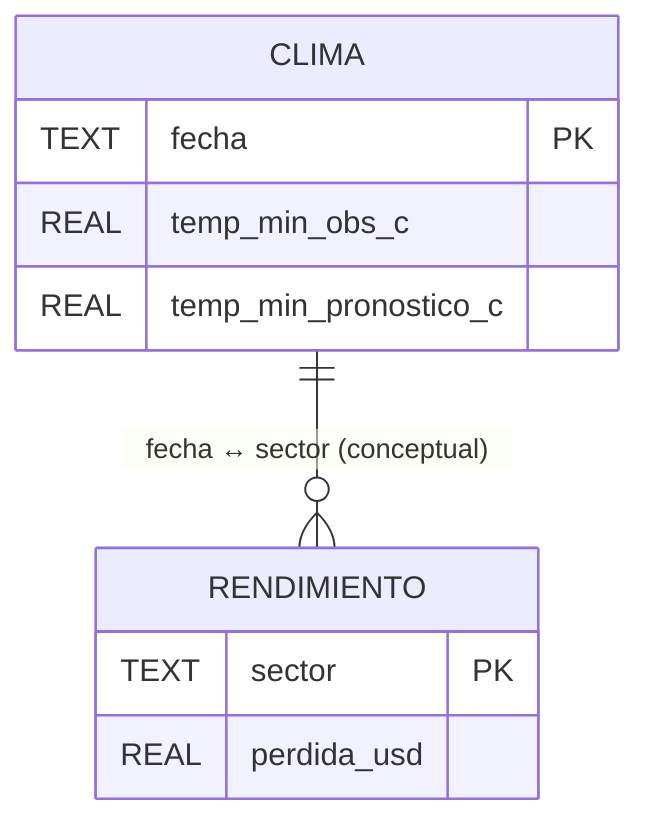

# Diseño de Datos — Data_Wizard

> No hay base de datos relacional. Los datos viven en 2 archivos CSV parseados en el navegador por PapaParse. Este documento documenta el esquema de cada CSV.

---

## Mapa de archivos de datos

| Archivo | Tipo | Descripción | Filas | ¿Se despliega? |
|---|---|---|---|---|
| `data/clima_valle_elqui.csv` | Clima diario | Mínimas observadas y pronosticadas + variables climáticas | 75 | Sí (en `public/data/` + embebido) |
| `data/rendimiento_fresa.csv` | Rendimiento por sector | 6 sectores con daño y pérdida del 18-jul | 6 | Sí (en `public/data/` + embebido) |

Ambos archivos se sirven al navegador vía fetch (cuando hay servidor) o fallback embebido (`<script type="text/csv">`).

---

## 1. clima_valle_elqui.csv — `data/clima_valle_elqui.csv`

**Origen:** Open-Meteo Archive API, procesado por `obtener_clima.py`. Frecuencia: regeneración manual. 75 filas (1-jun a 14-ago 2025).

### 1.1 Particularidades

- **Granularidad:** diaria (una fila por noche)
- **Pronóstico semi-simulado:** mínima observada + error gaussiano N(0, 1.1°C)
- **Inyección del escenario:** la noche más fría recibe pronóstico forzado por encima del umbral de activación (2.0 °C)
- **Sin valores NULL:** todas las columnas tienen valor en todas las filas

### 1.2 Diccionario de columnas

| Columna | Tipo | Unidad / Valores | Notas |
|---|---|---|---|
| `fecha` | TEXT | `YYYY-MM-DD` | PK — fecha de la observación |
| `temp_min_obs_c` | REAL | °C | Mínima observada (fuente de verdad) |
| `temp_max_obs_c` | REAL | °C | Máxima observada |
| `precipitacion_mm` | REAL | mm | Precipitación diaria |
| `radiacion_mj_m2` | REAL | MJ/m² | Radiación solar |
| `temp_min_pronostico_c` | REAL | °C | Pronóstico de mínima (σ=1.1°C); incluye inyección del escenario |

### 1.3 Clasificación por noche (calculada en JS)

| Variable | Fórmula | Valores |
|---|---|---|
| `flagged` | `pronóstico ≤ 2.0` | `true` = predije riesgo; `false` = predije seguro |
| `frost` | `observado ≤ −0.5` | `true` = helada real; `false` = sin helada |
| `resultado` | combinación de flagged + frost | `TP`, `TN`, `FP`, `FN` |

---

## 2. rendimiento_fresa.csv — `data/rendimiento_fresa.csv`

**Origen:** Cálculo manual del caso narrativo. Frecuencia: estático (no se regenera). 6 filas (un sector cada una).

### 2.1 Particularidades

- **Datos fijos:** es parte del caso narrativo; no cambia
- **Sector D es el caso crítico:** sin proteger en la noche del 18-jul → 65% daño → US$ 56.160 pérdida
- **Sin valores NULL:** todas las columnas tienen valor

### 2.2 Diccionario de columnas

| Columna | Tipo | Unidad / Valores | Notas |
|---|---|---|---|
| `sector` | TEXT | `A` – `F` | PK — identificador del sector |
| `superficie_ha` | REAL | hectáreas | Superficie del sector |
| `fenologia_18jul` | TEXT |描述 fenológica | Estado fenológico al 18-jul (ej: "plena floración") |
| `protegido_18jul` | TEXT | `sí` \| `no` | Si se activó protección la noche del 18-jul |
| `rendimiento_esperado_kg` | REAL | kg | Rendimiento esperado sin daño |
| `rendimiento_real_kg` | REAL | kg | Rendimiento observado post-helada |
| `dano_helada_pct` | REAL | % | Porcentaje de daño por helada |
| `perdida_usd` | REAL | US$ | Pérdida económica = (esperado − real) × precio/kg |

### 2.3 Datos del Sector D (caso crítico)

| Campo | Valor |
|---|---|
| Superficie | 1.2 ha |
| Fenología | Plena floración (más vulnerable) |
| Protegido 18-jul | **No** |
| Rendimiento esperado | 54.000 kg |
| Rendimiento real | 18.900 kg |
| Daño | 65% |
| Pérdida | **US$ 56.160** |

---

## 3. Relación entre archivos

> No hay FK real entre los archivos. La conexión es narrativa: el clima de la noche del 18-jul (en `clima_valle_elqui.csv`) causó el daño del Sector D (en `rendimiento_fresa.csv`). El JS cruza estos datos en runtime para calcular los costos.

---

## 4. Constantes del sistema

| Constante | Valor | Significado |
|---|---|---|
| `UMBRAL_ACTIVACION` | 2.0 °C | Se protege si pronóstico ≤ 2.0 °C |
| `UMBRAL_DANO` | −0.5 °C | Hay daño si observado ≤ −0.5 °C |
| `COSTO_NOCHE` | US$ 340 | Costo de una noche de protección |
| `PRECIO_KG` | US$ 1.6 | Precio de la fresa para valorizar pérdida |

Estas constantes están definidas en JS y se usan para todos los cálculos en vivo.
