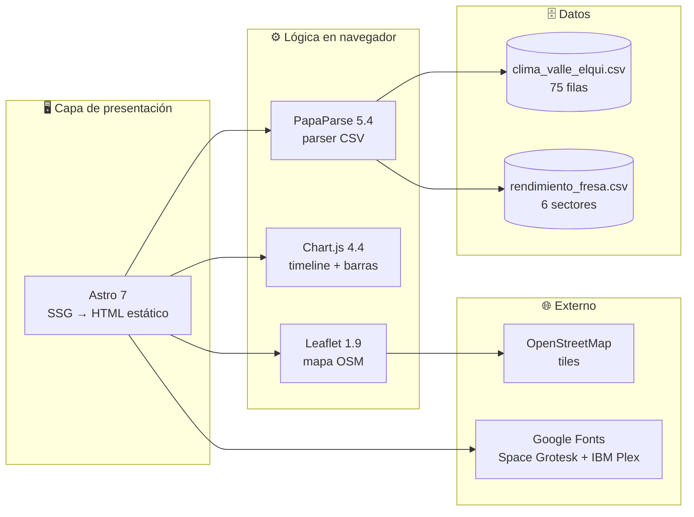
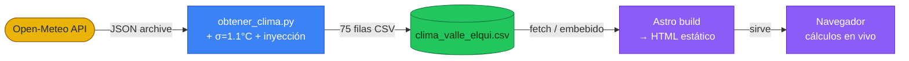
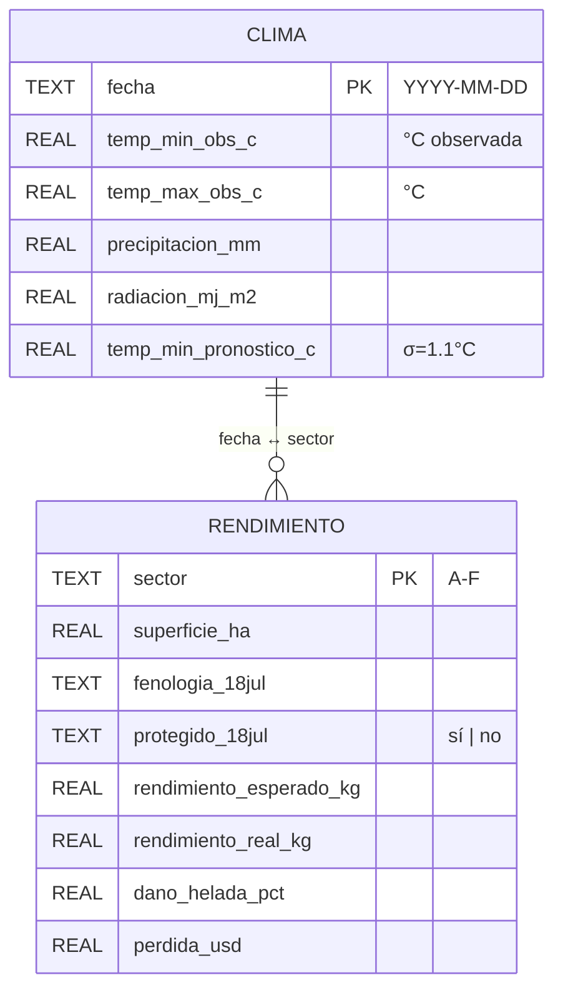

# Documento de Definición Técnica — Data_Wizard

> **Propósito:** Única fuente de verdad técnica y funcional para desarrolladores, arquitectos y agentes de IA. Define qué hace el sistema, cómo están organizados sus componentes, cómo fluyen los datos y qué reglas de negocio aplica.

---

## 0. Resumen ejecutivo

- **Propósito:** Presentación web interactiva que enseña el uso del Storytelling en Data Science a través del caso de la helada en fresa del Valle del Elqui, demostrando la asimetría entre tipos de error (falso positivo vs. falso negativo).
- **Usuarios objetivo:** Ponente (Alex) que presenta en vivo; público que interactúa con sliders y gráficos; visitantes posteriores que acceden vía GitHub Pages.
- **Casos de uso principales:**
  1. El ponente navega 19 diapositivas con storytelling estructurado (emboscada → clímax → cierre)
  2. El público interactúa con slider de umbral, cuadrícula de 75 noches y timeline para "sentir" el trade-off
  3. Cualquiera accede a la URL de GitHub Pages para revisar la presentación de forma autónoma

---

## 1. Arquitectura de componentes

### Glosario de componentes

| Componente | Responsabilidad | Tecnología | ¿Escribe o solo lee? |
|---|---|---|---|
| Astro 7 | Build estático, estructura de slides, inyección de CDN | Astro SSG | Solo lee (build time) |
| Chart.js | Timeline pronóstico vs. observado, barras por sector | CDN | Solo lee |
| Leaflet | Mapa interactivo con marcador del Elqui | CDN | Solo lee |
| PapaParse | Parseo de CSV en el navegador | CDN | Solo lee |
| clima_valle_elqui.csv | Datos climáticos diarios (75 noches) | CSV | Solo lee |
| rendimiento_fresa.csv | Rendimiento por sector (6 sectores) | CSV | Solo lee |

---

## 2. Flujos de datos

### 2.1 Entradas y salidas

| Dirección | Fuente / Destino | Tipo de dato | Frecuencia |
|---|---|---|---|
| Entrada | Open-Meteo Archive API (vía `obtener_clima.py`) | JSON → CSV | Manual (regeneración) |
| Entrada | Datos estáticos de sectores | CSV | Uno (creación manual) |
| Salida | 19 diapositivas web interactivas | HTML + JS | Por demanda (URL) |

### 2.2 Diagrama de flujo principal

---

## 3. Modelo de datos

> No hay base de datos relacional. Los datos viven en 2 archivos CSV parseados en el navegador. Ver `docs/db/diseno_db.md` para el diccionario completo.

---

## 5. Lógica de negocio y fórmulas

### 5.1 Índices y fórmulas calculadas

| Índice / Métrica | Fórmula | Umbrales |
|---|---|---|
| Clasificación por noche | `flagged = pronóstico ≤ UMBRAL_ACTIVACION` | UMBRAL_ACTIVACION = 2.0 °C |
| Helada observada | `frost = observado ≤ UMBRAL_DANO` | UMBRAL_DANO = −0.5 °C |
| TP / TN / FP / FN | Conteo de noches según clasificación vs. realidad | — |
| Exactitud | `(TP + TN) / total` | — |
| Modelo tonto | `Siempre "no helada" → TN / total` | — |
| Costo FP | `FP × COSTO_NOCHE` | COSTO_NOCHE = US$ 340 |
| Costo FN | Pérdida real del sector dañado | US$ 56.160 (Sector D) |
| Ratio asimetría | `Costo FN / Costo FP` | ~83× |

### 5.2 Reglas de negocio

- **UMBRAL_ACTIVACION (2.0 °C):** se activa protección si pronóstico ≤ 2.0 °C
- **UMBRAL_DANO (−0.5 °C):** hay daño si la mínima observada ≤ −0.5 °C
- **COSTO_NOCHE (US$ 340):** costo fijo de una noche de aspersión
- **Inyección del escenario:** en la noche más fría se fuerza el pronóstico por encima del umbral → nace la "amenaza no detectada"
- **Cálculo en vivo:** la matriz TP/TN/FP/FN, exactitud, costos y ratio se calculan en el navegador desde los CSV, nada hardcodeado en la lógica

---

## 6. Interfaz de usuario

### 6.1 Estructura de la interfaz

| Control | Tipo | Qué dispara |
|---|---|---|
| Flechas / Espacio / PageUp-Down | Navegación | Avanza/retrocede diapositiva |
| F | Tecla | Pantalla completa |
| Slider de umbral (−2 a +5 °C) | Slider | Recalcula TP/TN/FP/FN en vivo, cambia mensaje según régimen |
| Cuadrícula de 75 puntos | Grid visual | Colorea por resultado; FN con glow rojo |
| Timeline (Chart.js) | Gráfico | Observado vs. pronóstico + umbrales + punto rojo 18-jul |
| Barras por sector (Chart.js) | Gráfico | Esperado vs. real; Sector D en rojo |
| Contador animado | Animación | US$ 56.160 al entrar a "La cuenta" |
| Mapa (Leaflet) | Mapa | Marcador −30.03, −70.71; popup con noche crítica |

### 6.2 Comportamientos reactivos clave

- **Slider de umbral:** al mover la perilla → se reclasifican las 75 noches → se recalculan TP/TN/FP/FN, exactitud, costos y ratio → cambia el mensaje (exigente / equilibrado / nervioso)
- **Entrada a "La cuenta":** contador animado de US$ 56.160
- **Punto rojo en timeline:** resalta la noche del 18 de julio (+3.4 °C pronosticado → −1.6 °C observado)

---

## 7. Configuración y despliegue

### 7.1 Entornos

| Entorno | Cómo arrancar | URL / acceso | Datos que usa |
|---|---|---|---|
| Local / desarrollo | `npx astro dev --port 4321` | `http://localhost:4321` | CSV locales en `data/` |
| Producción / deploy | GitHub Pages (build automático) | URL del repo GitHub Pages | CSV embebidos + fetch |

### 7.2 Restricciones del entorno

- **OpenStreetMap tiles:** requieren internet la primera vez; sin internet el mapa no carga
- **Google Fonts:** requieren internet la primera vez
- **CSV fallback:** datos embebidos en `<script type="text/csv">` para funcionar con `file://`
- **Open-Meteo:** requiere licencia comercial para uso empresarial (el script `obtener_clima.py` lo documenta)
